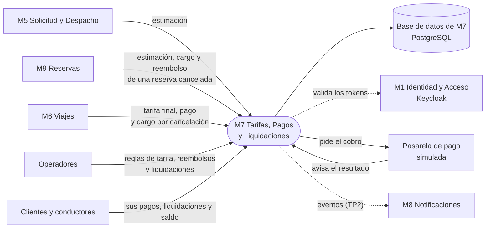
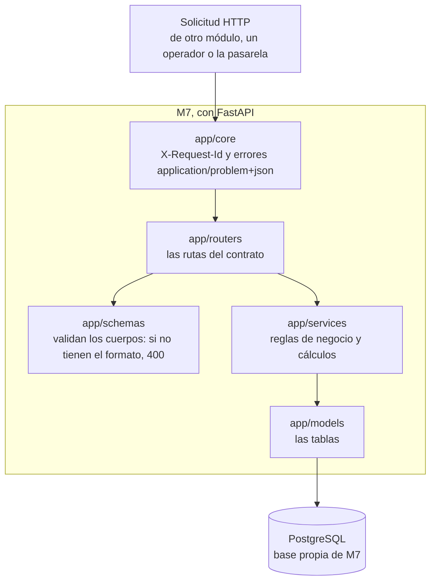
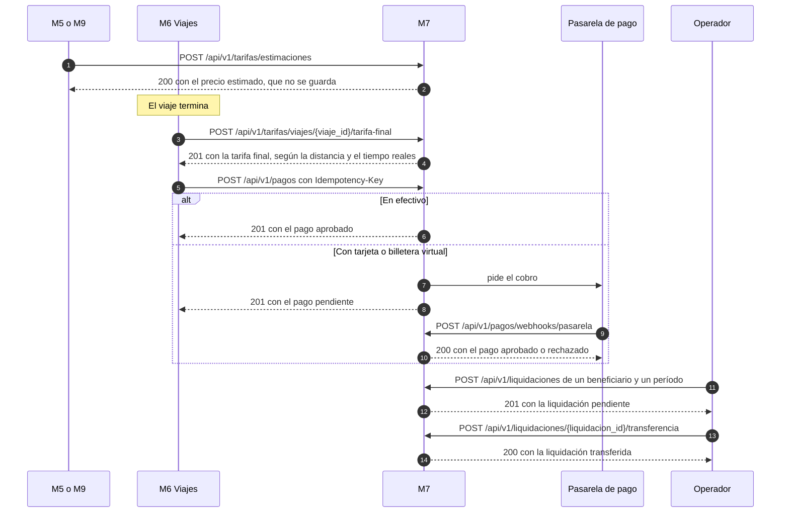

# Arquitectura de M7

Diagramas del módulo M7 (Tarifas, Pagos y Liquidaciones), sacados de la consigna y del contrato de M7. Están escritos con [Mermaid](https://mermaid.js.org/): GitHub los muestra como dibujos y se editan como texto, junto con el código (RNF-20).

## Contexto

Quién usa M7 y para qué. Cada flecha va de quien llama a quien responde.

M7 no llama a M4 (Ubicación): la distancia y el tiempo de cada viaje los mandan M5, M6 y M9, que los obtienen de M4. Los eventos para M8 llegan en el TP2, con la mensajería.

## Capas

Por dónde pasa una solicitud dentro de M7.

## Recorrido de un viaje

Cómo se cobra un viaje y cómo se le liquida al conductor, como lo describe el contrato.

